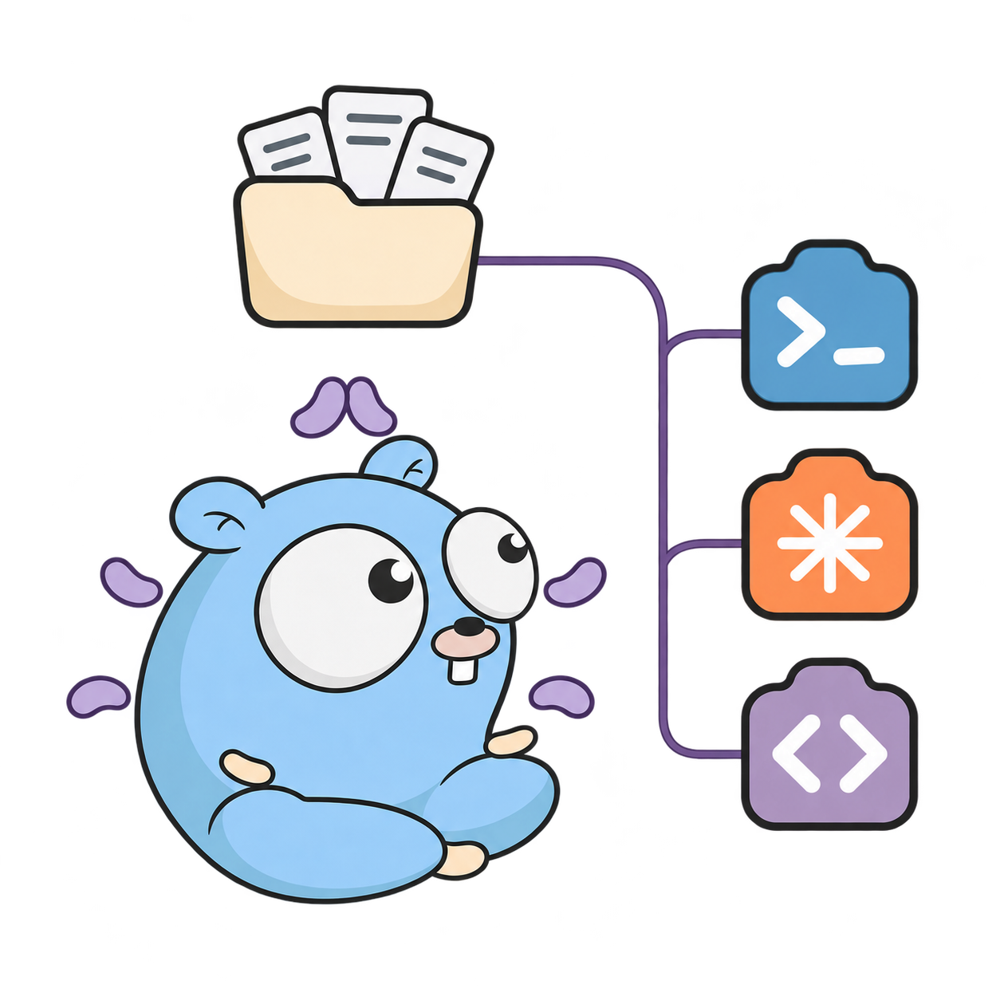

# agentbld

`agentbld` helps declaratively manage agent instructions, skills, and resources across harnesses.

Gives you the tools to organize, share and blend your agent context from multiple sources.

<p align="center">
  
</p>

- **Layer your configuration.** Manage agent instructions & skills in layers, compose your agent instructions from multiple files. Compose / override layers from multiple sources.
- **Tight controll.** Enable/Disable sections, or only enable them for certain harnesses.
- **Render a generation.** Keep generations for your chosen harnesses as a numbered, read-only snapshots, to avoid accidental modifications, and simplify rollback.
- **Sync by number.** Quickly switch between generations for quick rollback and comparisons.

Break up your configuration into sections to enable easy sharing, re-mixing, and blending configuration across work, home and other different setups that require tailoring.

## Run or install

### Nix flake

```sh
nix run github:NonLogicalDev/tool.agentbld -- --help
nix profile install github:NonLogicalDev/tool.agentbld
```

From a checkout, run `nix run . -- --version` or build with `nix build .`.

### Nix without flakes

From a checkout with `nixpkgs` in `NIX_PATH`:

```sh
nix-build
./result/bin/agentbld --version
```

Both entry points use [nix/package.nix](nix/package.nix). To reuse the recipe in a Nix configuration:

```nix
pkgs.callPackage ./nix/package.nix { }
```

The recipe accepts `source`, `version`, and `revision` overrides for a pinned package.

### Go

**Prerequisite** — Go 1.24 or later. Add `$GOBIN` to `PATH`, or use `$(go env GOPATH)/bin` if `GOBIN` is unset.

| Use | Version suffix |
| --- | --- |
| Track the main branch | `@main` |
| Pin a release once tagged | `@vX.Y.Z` |

```sh
go run github.com/NonLogicalDev/tool.agentbld/cmd/agentbld@main --help
go install github.com/NonLogicalDev/tool.agentbld/cmd/agentbld@main
```

## Configuration layout

- Pass your own sections directory with `--sections-dir`. See [source sections][source-sections] for the format.

```text
sections/
└── {nn}-{ns}-{suffix}/
    ├── AGENTS.md.d/
    │   └── {order}-{section}.md
    ├── skills/
    │   └── {skill-name}/
    │       ├── SKILL.md.d/
    │       │   ├── 10-skill.md
    │       │   └── {order}-{fragment}.md
    │       ├── references/
    │       └── scripts/
    ├── resources/
    │   └── {resource-group}/
    │       └── {resource-name}
    └── opencode/plugins/
        └── {plugin-name}.js
```

- Override the generation directory with `--render-dir`.
- `config.json` records resolved modes. Destination paths are chosen at sync time.
- The selected source files and resolved options determine whether render reuses the newest generation.

```text
${XDG_STATE_HOME:-$HOME/.local/state}/agentbld/
├── latest -> {yyyy}-{mm}-{dd}__{NN}/
└── {yyyy}-{mm}-{dd}__{NN}/
    ├── config.json
    ├── codex/           # If selected
    │   ├── AGENTS.md
    │   ├── skills/
    │   ├── plugin-skillset/  # If a plugin is selected
    │   ├── resources/
    │   └── rules/
    ├── opencode/        # If selected
    │   ├── AGENTS.md
    │   ├── skills/
    │   ├── resources/
    │   └── plugins/
    └── claude/          # If selected
        ├── CLAUDE.md
        ├── skills/
        ├── plugin-skillset/  # If a plugin is selected
        └── resources/
```

## Operations

| Command | Use it to | Input |
| --- | --- | --- |
| `render` | Create or reuse a generation | Source sections |
| `render --sync` | Render and activate that exact generation | Source sections and destinations |
| `check` | Verify the newest generation and `latest` without writing | Source sections and render options |
| `sync <number>` | Activate a saved generation | Ordinal and destinations |
| `modes` | List harness options and examples | — |
| `prune` | Keep the five newest generations | State root with no active links to older generations |
| `reset` | Back up Codex config and remove stale managed links | Codex destination and state root |

- **Check exit codes**
  - `0` — current
  - `1` — stale
  - `2` — error
- **Numbered sync**
  - Uses the saved files and options. Omit source flags.
  - Leaves `latest` pointing to the newest generation.
  - Repeat bare `--mode` names to select harnesses.
  - Requires the current generation layout and `config.json`. Render into a fresh state directory when upgrading.

```sh
# Run from the directory that contains your sections/.
agentbld render --sections-dir "$PWD/sections"
agentbld check --sections-dir "$PWD/sections"
agentbld render --sync --sections-dir "$PWD/sections"
agentbld sync 1  # Replace 1 with the ordinal printed by render.
```

## Configuration paths

```sh
agentbld config paths
agentbld config paths --sections-dir ./sections --render-dir ~/agentbld-state --codex-dir ~/.codex-work
```

- `effective` includes path flags and the current environment.
- `defaults` uses the current environment with all path flags omitted. There is no default sections directory.
- Both list the state paths, profile directory, and every harness’s destinations, including marketplaces.
- The command reads path options only. It creates no files and loads no saved profile.

## Sync profiles

```sh
agentbld sync 1 --mode=codex --codex-dir /path/to/codex --save-profile work
agentbld sync 2 --profile work
agentbld profile list
agentbld profile show work
```

| Setting | Behavior |
| --- | --- |
| Directory | `${XDG_CONFIG_HOME:-$HOME/.config}/agentbld/` |
| Default file | `default.json`, selected with `--profile default` |
| Named file | `<name>.json`, selected with `--profile <name>` |
| List profiles | `agentbld profile list` prints names in alphabetical order |
| Inspect a profile | `agentbld profile show NAME` prints its JSON. Use `default` to inspect `default.json`. |
| Save | `--save-profile <name>` creates or replaces the file after successful activation |
| Precedence | Explicit sync flags, then the selected profile, then the normal defaults |

- **Saved fields**
  - `render_dir`
  - `modes`, a list of selected harness names
  - Destination fields for the selected harnesses
- **Portable paths**
  - Saved paths under your home directory start with `~/`. Sync expands them against the current home.
  - Paths outside your home stay absolute.
- **Selection** — omit `--profile` to use regular flags and defaults.
- **Generation** — pass its ordinal each time. Each generation supplies its own mode options.
- **Mode overrides** — supplying `--mode` replaces the profile's entire harness list for that invocation.
- **Names** — start with a letter or digit and use letters, digits, underscores, or hyphens.

Example `work.json`

```json
{
  "render_dir": "~/.local/state/agentbld",
  "modes": ["codex"],
  "codex_dir": "~/.codex-work",
  "codex_marketplace_home": "~/.agents/plugins"
}
```

Save or select the profile named `default`.

```sh
agentbld sync 2 --profile work --save-profile default
agentbld sync 3 --profile default
```

## Harnesses

- **Render** — pass `--mode=<harness>[:<JSON object>]` once per harness.
- **Sync**
  - Supply destination flags. Sync resolves placeholders for those destinations.
  - Unrelated entries stay in place. Unmanaged conflicts block sync.
- **Plugin packaging** — Codex and Claude Code use source `skills/` and render a separate `plugin-skillset/`.
  Sync writes local packages. Register or install them through the harness.

### Codex

| Sync flag | Default |
| --- | --- |
| `--codex-dir` | `${CODEX_HOME:-$HOME/.codex}` |
| `--codex-marketplace-home` | `$HOME/.agents/plugins` |

See [Codex examples, mode options and command rules][codex-config].

### OpenCode

| Mode option | Selects | Default |
| --- | --- | --- |
| `agents` | `AGENTS.md` and resources | On |
| `skills` | Standalone skills | On |
| `plugins` | Native plugins | On |

`--opencode-dir` overrides `$OPENCODE_CONFIG_DIR` or `${XDG_CONFIG_HOME:-$HOME/.config}/opencode`.

### Claude Code

| Plugin selection | `agents` default | `skills` default | Plugin includes `Agent_Guidance` |
| --- | --- | --- | --- |
| No plugin | On | On | — |
| `"skills"` | On | Off | No |
| `"full"` | Off | Off | Yes |

- **`agents`** selects `CLAUDE.md` and resources. **`skills`** selects standalone skills.
- **Overrides**
  - Set `agents` and `skills` explicitly to override the defaults.
  - Set `plugin_name` to choose a name. Defaults to `skillset`.
- **Standalone links**
  - Plugin-only sync leaves the Claude configuration directory untouched.
  - When syncing instructions and a plugin with `skills` off, sync removes previously managed skill links.

| Sync flag | Default |
| --- | --- |
| `--claude-dir` | `${CLAUDE_CONFIG_DIR:-$HOME/.claude}` |
| `--claude-marketplace-dir` | `${XDG_DATA_HOME:-$HOME/.local/share}/agentbld/claude-marketplace` |

**Install the generated plugin after sync**

```sh
claude plugin marketplace add "${XDG_DATA_HOME:-$HOME/.local/share}/agentbld/claude-marketplace"
claude plugin install skillset@agentbld
```

- Use your configured path and names if they differ. See the
  [Claude Code marketplace documentation](https://code.claude.com/docs/en/plugin-marketplaces).

## Development

- **Entry point and CLI** — `cmd/agentbld/main.go` and `internal/`.
- **Shared engine code** — `internal/engine/` handles source layering, generation storage, replay, and managed links.
  - Shared filesystem helpers also live here.
- **Harness engines** — under `internal/harnesses/`
  - `harness_codex/`
  - `harness_claude/`
  - `harness_opencode/`
- **Tests**
  - Unit tests live beside the code they exercise.
  - CLI integration tests build and run the binary from `internal/integration_tests/`.
  - Run `go test ./...` from the repository root.

## Releases

- Push a semantic version tag such as `v0.1.0` to trigger the GitHub release workflow.
- GoReleaser packages macOS and Linux binaries for amd64 and arm64, with SHA-256 checksums.
- `agentbld --version` prints the release version and full commit hash.
- Build release artifacts locally with a snapshot.

```sh
goreleaser release --config .github/actions/goreleaser.yaml --snapshot --clean
```

## History

Agentbld was extracted from [NonLogicalDev/conf.agents][original-source] with its Git history.

[source-sections]: https://github.com/NonLogicalDev/conf.agents#source-sections
[codex-config]: https://github.com/NonLogicalDev/conf.agents#codex
[original-source]: https://github.com/NonLogicalDev/conf.agents/tree/819153a/utils/agentbld
